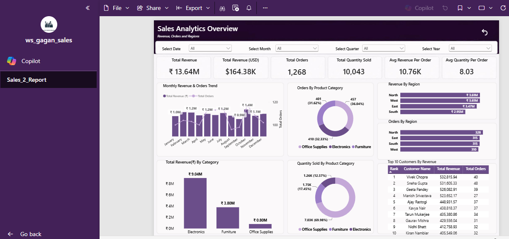

## 1.	Project Title / Headline 📑
Sales Analytics Overview Dashboard : End-to-End Microsoft Fabric & Power BI Sales Insights Dashboard

## 2. Short Description / Purpose 🎯
The Sales Analytics Overview dashboard is an interactive Power BI report backed by a Microsoft Fabric data pipeline, Lakehouse, and Data Warehouse. It provides business leaders, sales managers, and data analysts with real-time visibility into total revenue, total orders and total units sold, enabling data-driven decisions around regional growth, inventory allocation, and key customers retention.

## 3. Tech Stack 💻  
The dashboard was built using the following tools and technologies:  
- Microsoft Fabric Data Pipelines  – Orchestrates automated end-to-end ingestion, notebook transformations, and warehouse loading.
- Microsoft Fabric Lakehouse  – Stores raw CSV files (Files/raw) and Delta tables across a Medallion architecture (bronze_sales, silver_sales, and gold_sales_summary).
- Fabric Notebooks (PySpark / Spark SQL) – Executes ETL logic across pipeline stages (copydatatodelta, TransformBronzeToSilver, BuildGoldLayer).
- Microsoft Fabric Data Warehouse  – Formated the curated star schema (fact_sales, dim_customer, dim_date, dim_product, dim_region) for analytical querying.
- Power BI Semantic Model & DAX – Connects the warehouse tables to the reporting layer with calculated measures.
- Power BI  – Main data visualization platform used for report creation.
## 4. Features / Highlights:
### 📌 Business Problem
The sales team was struggling with scattered, raw CSV files, making it slow and difficult to track overall revenue, regional performance, and top customers. We needed an automated system in Microsoft Fabric to clean and organize this data into a single warehouse, paired with an interactive dashboard so leadership can easily monitor monthly trends and product category sales in one place. 
### 📌 Goal of the Dashboard
The primary goal of this dashboard is to deliver an automated, interactive analytical solution that can eliminate the need of uploading data manually,track monthly revenue and order trends alongside category performance, regional sales, and top customers, the team can easily spot growth opportunities, identify underperforming areas, and stay on top of overall business targets without digging through spreadsheets.
### 📌 Walkthrough of Key Visuals
* Interactive Time Slicers : Dropdown filters for Date, Month, Quarter, and Year allow users to dynamically filter every KPI and chart on the report.
* KPI Cards : Total Revenue (₹13.64M), Total Revenue in USD ($164.38K), Total Orders (1,268), Total Quantity Sold (10,043), Avg Revenue Per Order (₹10.76K), Avg Quantity Per Order (8.03 units).
* Monthly Revenue & Orders Trend ( Line & Clustered Column Chart): Tracks monthly revenue against total orders from January to December, highlighting peak sales in October (₹1.4M) and least sales in the month of September (₹0.9M).
* Orders By Product Category (Donut Chart): Shows an even distribution of orders volume across Electronics, Furniture and Office Supplies Category.
* Total Revenue By Category (Column Chart): Compares revenue contribution by category, revealing that Electronics dominates the market by making revenue at ₹9.04M, followed by Furniture (₹3.80M) and Office Supplies (₹0.80M).
* Quantity Sold By Product Category (Donut Chart): Displays units volume distribution, where Office Supplies leads with 7.03K units compared to Furniture and Electronics.
* Revenue & Orders By Region (Horizontal Bar Charts): Compares regional performance of the sales across North, West, East, and South, showing North and West tied for the top revenue making region whereas North leading in orders volume.
* Top 10 Customers By Revenue (Ranked Table): Lists the Top 10 highest-spending customers.
### 📌 Business Impacts
* Eliminated the need of Manual Reporting: Automating the pipeline in Microsoft Fabric removed the need to manually merge and clean CSV files, saving hours of reporting time every week.
* Targeted Regional Strategy: Leadership can now focus marketing efforts and sales support on the South region to close the revenue gap with the North and West.
* Customer Retention: Identifying the top 10 revenue-generating customers enables targeted loyalty programs and proactive account management for high-frequency buyers.
## Dashboard Preview 📷  
This is how the dashboard looks like :

